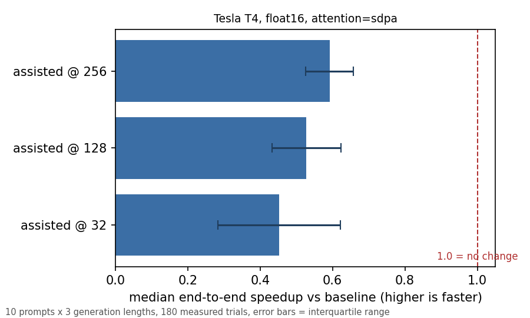
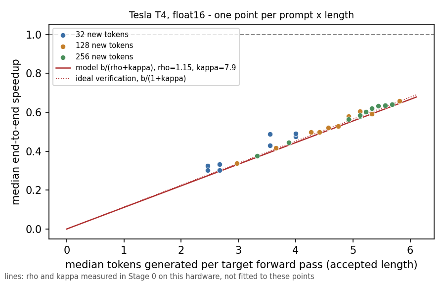
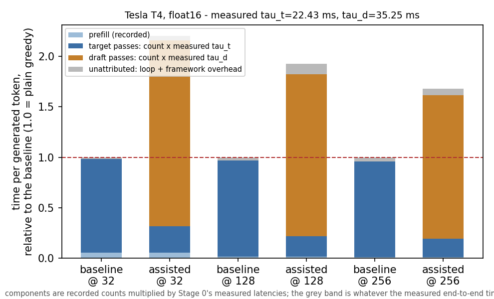

# TinyTurbo — Benchmarking Speculative Decoding for LLM Inference

A reproducible measurement of assisted (speculative) decoding: a 135M model drafts tokens, a
1.7B model verifies them in one forward pass, and the pair is timed against plain greedy
decoding on the same GPU, prompts and generation lengths.

**Assisted decoding was slower than plain greedy at every one of the 30 measured points, and the
reason is measured rather than assumed: the 135M draft pass costs 1.57× the 1.7B target pass, so
the auxiliary model costs more than the verify passes it saves.** The relative loss shrinks as
generation gets longer, and the outputs are token-identical to plain greedy throughout.

---

## Key results

| | |
|---|---|
| Hardware | Tesla T4 (Colab free, 2 vCPU), 15 GB, driver 580.82.07, CUDA 13.0 |
| Target model | `HuggingFaceTB/SmolLM-1.7B`, float16, SDPA attention |
| Assistant model | `HuggingFaceTB/SmolLM-135M`, float16, SDPA attention |
| Lookahead | γ = 5 assistant tokens per verification pass |
| Generation lengths | 32, 128, 256 new tokens |
| Scope | 10 prompts × 3 lengths × 2 methods × 3 measured trials = 30 points, 180 measured records |
| Protocol | 2 discarded warm-up trials per point, arms interleaved, medians and IQRs (never means) |
| Output correctness | token-identical to the paired baseline in **90 / 90** assisted measured trials |
| Runtime | ≈24 minutes of measurement on one T4, plus a one-time ~6.8 GB checkpoint download |

Speedup is defined as `baseline latency / assisted-decoding latency`. **A value below 1.0× is a
slowdown.**

| generation length | points | median end-to-end speedup | IQR | decode-only speedup | tokens per target forward pass |
|---|---|---|---|---|---|
| 32 | 30 | **0.452** | 0.169 | 0.443 | 3.56 |
| 128 | 30 | **0.528** | 0.095 | 0.525 | 4.66 |
| 256 | 30 | **0.592** | 0.066 | 0.591 | 5.17 |
| all | 90 | **0.528** | 0.171 | 0.525 | — |

* **Every point is a slowdown.** Per-point medians run from 0.659 (`s3-01-grounded` @ 128) down
  to 0.303 (`s2-01-long-open` @ 32); pooled, assisted decoding is about 1.9× slower.
* **Output correctness holds everywhere.** All 90 assisted measured trials produced token ids
  identical to their paired baseline (`exact_match: True`), which is the losslessness property
  assisted *greedy* is supposed to have.
* **Accepted length explains the shape.** Tokens emitted per target forward pass rise from 3.56
  to 5.17 as generation lengthens, and track speedup with a Spearman correlation of 0.98 pooled
  (0.91 / 0.97 / 0.97 within each length). More tokens per verify pass means fewer passes per
  token, which is why the loss is smallest at 256 tokens — but never small enough to cross 1.0.

---

## Figures



**Figure 1 — the headline measurement.** Median end-to-end speedup per method/length, error bars
are interquartile ranges over the trials of each point. The dashed line at 1.0 is break-even;
every bar is left of it. Regenerated by `report` from `results/raw/`.



**Figure 2 — the mechanism, scored.** The scatter is measured: one point per (prompt, generation
length), median accepted length against median speedup. The two straight lines are **model
predictions**, not fits — `b / (ρ + κ)` and its ideal-verification simplification `b / (1 + κ)`,
drawn with ρ = 1.147 and κ = 7.858 measured independently by `tinyturbo calibrate` (Stage 0). They
are only drawn when a calibration describing this run's machine exists; with the calibration
removed the figure is drawn without them.



**Figure 3 — where the token time goes, from the cost model.** Each component is a *recorded
count* multiplied by a *measured* Stage 0 latency, normalised so the baseline is 1.0; the grey
band is whatever the measured end-to-end time has left over. It is a model-based decomposition of
a small residual, not a profile of the decode loop — see
[Limitations](#limitations) and `docs/FINDINGS.md` §5 and §9.

---

## Problem and approach

Autoregressive decoding emits one token per target-model forward pass, so generation latency
scales with output length and the target's weights are re-read for every token. Speculative
decoding attacks that: a cheap assistant proposes several tokens, the target verifies them all in
a single forward pass, and the longest accepted prefix plus one corrected token is emitted. When
the assistant's proposals are good, one target pass yields several tokens instead of one.

The catch is that the assistant is not free. Its forward passes are serialised with the target's,
so unless the draft pass is much cheaper than the target pass and acceptance is high, the extra
work outweighs the saved verify passes — which is what this project measures. The cost model is
`speedup ≈ b / (ρ + κ)` for `b` tokens accepted per target pass, `ρ` the verification premium and
`κ = γ · τ_d / τ_t` the relative draft cost.

```text
prompt ──► prefill (measured separately)
              │
              ▼
        ┌─── decode loop, repeated until the token budget is spent ───┐
        │  assistant drafts γ candidate tokens   (γ forward passes)  │
        │  target verifies all γ+1 in ONE forward pass               │
        │  longest accepted prefix is emitted, plus one corrected    │
        └────────────────────────────────────────────────────────────┘
```

This study measures both terms: the benchmark times the two arms end to end, and a separate
calibration (**Stage 0**) times the three primitives directly, so the gap between the theoretical
bound and the observed speedup can be attributed rather than guessed.

---

## Experimental setup

| | |
|---|---|
| Models | `HuggingFaceTB/SmolLM-1.7B` (target) and `HuggingFaceTB/SmolLM-135M` (assistant), both public on the Hub — no token required |
| GPU | Tesla T4, compute capability 7.5, 15 360 MiB total, peak reserved during a trial ≈ 3.8 GB |
| Precision / attention | float16 / `sdpa`. bfloat16 is slow on CC 7.5 and FlashAttention-2 is unavailable there, so `sdpa` is the only supported fast backend on this card |
| Runtime | Python 3.13.15, PyTorch 2.11.0+cu130, Transformers 5.3.0 (Colab, Linux) |
| Prompts | 10 hand-written prompts in four strata: `S1-short-open`, `S2-long-open`, `S3-grounded`, `S4-repetitive` (`configs/prompts.jsonl`) |
| Generation lengths | 32, 128, 256 new tokens, greedy decoding throughout |
| Lookahead | γ = 5 for the assisted arm, fixed, `assistant_confidence_threshold: 0.0` |
| Trials | 2 discarded warm-ups then 3 measured trials per point, arms interleaved so thermal drift is not mistaken for a treatment effect; aggregates are medians with IQRs |
| Timing | `prefill_ms` is one forward pass over the prompt with an empty cache; `e2e_ms` is the timed `generate()` call; `decode_ms_per_token = (e2e_ms − prefill_ms) / tokens_generated` |
| Correctness | the generated token ids are compared with the paired baseline's and recorded as `exact_match` |
| Measurements | forward-pass counts on both models (via forward hooks), wall-clock timings, and CUDA memory high-water marks, all recorded per trial in `results/raw/` |

**Stage 0 (`tinyturbo calibrate`)** times τ_t (one target pass over 1 query token),
τ_t^verify (one target pass over γ+1 = 6 query tokens) and τ_d (one assistant pass), each as 5
discarded warm-ups plus 20 timed passes, reported as a median with an IQR and raw samples. On
the T4 above: τ_t = 22.431 ms, τ_t^verify = 25.737 ms, τ_d = 35.250 ms, hence ρ = 1.147,
κ = 7.858 and τ_d / τ_t = 1.572.

**Stage 4 (`tinyturbo profile`)** traces two representative sweep cases with the target's and
assistant's forward passes labelled, so device time can be attributed to drafting versus
verification. It ran with `--trace-active 8`, a bounded window of 8 target forward passes per
arm; the whole-generation trace is the one protocol that never completed on a free-tier instance.
**The Stage 4 trace ran in a different runtime from the sweep and the calibration** (driver
580.178.04, CUDA 12.8, torch 2.11.0+cu128, Kaggle), which is itself part of the result below.

Two library behaviours were read out of the installed `transformers` 5.3.0 source and pinned
explicitly in `src/tinyturbo/methods.py`, because either would have silently corrupted the
comparison: `num_assistant_tokens` passed to `target.generate()` is ignored (the draft length
comes from the assistant's *own* `generation_config`, default 20 — not the documented 5), and
`assistant_confidence_threshold` defaults to 0.4, which would have quietly turned the assisted
arm into an adaptive-lookahead run.

---

## Results and interpretation

**Measured (benchmark, 180 records).** Assisted greedy is slower at every point, by 1.9× pooled,
with the loss shrinking as generations lengthen (0.452 → 0.528 → 0.592). Output is
token-identical to the baseline in 90 of 90 assisted trials. Tokens per target forward pass
explains the trend: 3.56 → 4.66 → 5.17.

**Measured (Stage 0, same card).** A 135M draft forward pass costs 1.572× a 1.7B target forward
pass — the same 1.57–1.61× ratio the sweep's own pass counts implied, arrived at independently.
With both terms of the model measured, `b / (ρ + κ)` predicts 0.395 / 0.517 / 0.574 at the three
lengths against observed 0.452 / 0.528 / 0.592: residuals of +0.058 / +0.010 / +0.018, inside
the trial noise at every length (the IQR at 32 tokens alone is 0.169).

**Model-derived (not independently validated).** The cost model above is *scored* by the data but
was not fitted to it, and the one hypothesis it was built to expose did not survive: the
verification premium it was meant to find is 1.6 % of a modelled iteration. Figure 3's component
split is arithmetic over recorded counts and measured latencies, not a profile.

**Profiler observation (Stage 4, different runtime).** The bounded trace's per-pass means came
out **1.6–2.0×** the Stage 0 primitives, and the mismatch is a roughly *constant* ≈20 ms offset
per labelled pass (+16.0 to +22.4 ms across six measurements). A constant additive offset is
also exactly what compresses the draft/target ratio from 1.572 to 1.29–1.32. Two explanations fit
and this dataset cannot separate them: profiler overhead inside the recording window, and the
different driver/torch build. It is reported as an unresolved discrepancy with the experiment
that would settle it, not as a decomposition.

**Hypotheses left open.** Prompt-lookup, the adaptive lookahead schedules and ensemble
verification were never run (H1, H2, H7 — out of scope by design); H5's magnitude is not testable
from this prompt set, and H8 (sm80+) is untestable without that hardware.

---

## Reproducing this

```bash
# 1. Clone
git clone https://github.com/yashkapur0403/TinyTurbo.git
cd TinyTurbo

# 2. Environment - PyTorch first, because the right wheel depends on your platform
python -m venv .venv
source .venv/bin/activate            # Windows: .venv\Scripts\activate
python -m pip install torch==2.10.0  # CPU wheel, for local development
python -m pip install -r requirements.txt --no-deps
python -m pip install -e . --no-deps

# 3. Check the code (158 tests, no GPU and no network needed)
python -m pytest
```

**Reproduce the published tables and figures — no GPU required.** The raw records and the
Stage 0 calibration are committed, and the calibration matches the sweep's manifest, so
`report` works from a clean clone:

```bash
python -m tinyturbo report --config configs/gpu_main.yaml   # CSV + figures 1-3
python -m tinyturbo verify --config configs/gpu_main.yaml   # exit 0 if the records are usable
```

This rewrites `results/benchmark_results.csv` (180 rows) and all three figures in `plots/`. It
must reproduce the committed files rather than approximate them: the same 180 rows in the same
order, and figures whose sha256 matches the ones recorded in `docs/FINDINGS.md`. Move
`results/calibration/` aside and figure 2 loses its cost-model lines and figure 3 disappears —
that is the calibration guard working, not a failure.

**Re-run the benchmark itself (needs a CUDA GPU).** Nothing here was measured on CPU; a CPU run
of the same config would produce numbers that look like results and are not.

```bash
python -m tinyturbo run    --config configs/gpu_main.yaml   # ~24 min on a T4, plus ~6.8 GB of weights
python -m tinyturbo verify --config configs/gpu_main.yaml
python -m tinyturbo report --config configs/gpu_main.yaml
```

`run` resumes: a trial is skipped when its `(prompt, length, method, trial)` key is already
recorded, so an interrupted session appends instead of restarting. Add `--force` to re-measure,
or `--trials 1` for a ~15-minute single-trial pass over the same grid. The runner refuses to
append to records from a different GPU or driver rather than pooling two machines into one
average.

**CPU smoke test (plumbing only).** Runs the same code path on a real checkpoint with no GPU. Its
numbers are a plumbing check and are tagged as a smoke run in the output and the figure titles,
because on CPU the assistant is exactly as expensive as the target:

```bash
python -m tinyturbo run    --config configs/slice_cpu.yaml
python -m tinyturbo report --config configs/slice_cpu.yaml
```

**Hosted GPUs (Colab / Kaggle).** Build the upload bundle with
`python scripts/make_colab_bundle.py`, then install with `requirements-colab.txt` instead of
`requirements.txt` — the hosted image already ships a CUDA torch and a numpy compiled against it,
and replacing either can require a runtime restart. On Colab, `notebooks/colab_gpu_smoke.ipynb`
carries the full sequence (preflight, upload, install, smoke slice, sweep, Stage 0 + Stage 4). On
Kaggle, upload `TinyTurbo.zip` as a Dataset and attach it to the notebook as an input before
unpacking it; the Stage 4 trace in `results/profiling/` was produced that way. The two models
need ≈3.8 GB of device memory together, but the *unbounded* Stage 4 trace needs a multiple of
that for its event buffer: it was killed by a free Colab session's memory limit (exit 137) and
only the bounded trace fits, which is why `--trace-active` exists.

Stage 0 and Stage 4 must run on the same card as the sweep they will be compared with:

```bash
python -m tinyturbo calibrate --config configs/gpu_main.yaml   # Stage 0: rho, kappa
python -m tinyturbo profile   --config configs/gpu_main.yaml   # Stage 4: two traced cases
python -m tinyturbo report    --config configs/gpu_main.yaml   # re-score with the calibration
```

If the calibration describes a different machine, configuration or lookahead than the run,
`report` prints the differences, draws figure 2 without the cost-model lines and writes no figure
3 — a deliberate refusal, not a bug to work around.

---

## Project layout

```text
src/tinyturbo/
  config.py      YAML -> validated config object, plus a content fingerprint
  env.py         device/dtype/attention resolution and the hardware fingerprint
  prompts.py     the fixed prompt set
  models.py      loading the target and the assistant
  instrument.py  forward-pass counters, synchronising stopwatch, memory readings
  methods.py     the exact generate() kwargs for baseline vs assisted
  metrics.py     pure functions; every formula in the report lives here
  runner.py      runs the trials, writes one JSON line per trial
  report.py      raw records -> validated CSV + figures + the cost-model comparison
  calibrate.py   Stage 0: tau_t, tau_t_verify and tau_d, measured on hardware
  profiling.py   Stage 4: two representative cases traced with labelled forward passes
  cli.py         run | report | verify | calibrate | profile
configs/         the prompt set, the Stage 1 sweep, and three single-point slice configs
tests/           runs without a GPU and without network access
results/raw/     the evidence: one JSONL record per run; derived files are regenerated from it
results/sessions/  what each Colab/Kaggle session downloaded, verbatim, with checksums
results/calibration/  Stage 0 artifacts, keyed by run id and checked before use
results/profiling/    Stage 4 artifacts, keyed by run id
plots/           the figures, regenerated by `report` from results/raw/
docs/PLAN.md     the pre-registered plan this study is scored against
docs/FINDINGS.md findings, measured-vs-estimated distinctions, and what is still open
notebooks/       the hosted-GPU notebook
```

---

## Limitations

* **Assisted decoding did not beat the baseline in this configuration**, at any of the 30 points.
  One GPU, one model pair, one session, γ = 5; that is one configuration, not a verdict on the
  method.
* **Three measured trials per point is thin for comparing adjacent points.** The IQR at 32 tokens
  (0.169) is larger than the gap between the 32- and 256-token medians (0.140), so the *trend* is
  solid and individual points are not.
* **The CUDA profiling used a bounded recording window** (8 target forward passes per arm), so
  `attributed_ms` and `unattributed_ms` are `null` by construction and no whole-generation
  bottleneck attribution exists. The trace's absolute numbers are also not comparable with
  Stage 0's: it ran on a different driver and torch build, and the ≈20 ms per-pass discrepancy
  between them is unresolved. Re-running the same command on the calibration's own
  driver/torch image is the experiment that would settle it.
* **The cost model is scored, not validated.** Stage 0 measured its two inputs, so the model's
  residual is a real test rather than a fit — but its agreement with the sweep is agreement on
  one machine and one model pair, and it is not evidence that the model generalises.
* **Coverage.** One prompt set (10 hand-written prompts of 8–369 tokens; the `S2-long-open`
  stratum was specified at 300–1000 tokens and tokenises to 174–188, so workload dependence is
  tested over ten short prompts rather than a corpus), one method family, greedy decoding only,
  CC 7.5 only. H1/H2/H7 are untested by scope, H5's magnitude is untestable from these prompts,
  and H8 needs sm80+ hardware.
* `decode_ms` is derived from a separately measured prefill, so it is an upper bound on decode
  time rather than an exact decomposition — labelled as such in every record.

Detailed methodology, per-hypothesis scoring and the full caveat list: `docs/FINDINGS.md`.

---

## Further information

| | |
|---|---|
| Findings and open questions | [`docs/FINDINGS.md`](docs/FINDINGS.md) |
| Pre-registered plan and hypotheses | [`docs/PLAN.md`](docs/PLAN.md) |
| Run log: every run, its machine and its command | [`results/README.md`](results/README.md) |
| The sweep's checksums, scope and what it does not settle | [`results/sessions/gpu-main-9e26c12945e6/README.md`](results/sessions/gpu-main-9e26c12945e6/README.md) |
| Stage 0 artifact | [`results/calibration/gpu-main-9e26c12945e6-calibration.json`](results/calibration/gpu-main-9e26c12945e6-calibration.json) |
| Stage 4 artifact | [`results/profiling/gpu-main-9e26c12945e6-profiling.json`](results/profiling/gpu-main-9e26c12945e6-profiling.json) |
| Raw evidence | [`results/raw/`](results/raw) |
| Aggregate table | [`results/benchmark_results.csv`](results/benchmark_results.csv) |
| Configurations | [`configs/gpu_main.yaml`](configs/gpu_main.yaml), [`configs/slice_cpu.yaml`](configs/slice_cpu.yaml), [`configs/slice_gpu.yaml`](configs/slice_gpu.yaml), [`configs/profile_smoke.yaml`](configs/profile_smoke.yaml) |
| Hosted-GPU notebook | [`notebooks/colab_gpu_smoke.ipynb`](notebooks/colab_gpu_smoke.ipynb) |

**How the evidence chain works.** One JSON line per trial, flushed as it is written, so an
interrupted session keeps everything that already finished. Raw records hold observations only:
every speedup is computed at report time from a paired baseline, so a ratio whose baseline does
not exist cannot be stored. `validate_run` refuses to report a trial that cannot be traced to its
run manifest or that came from a different configuration, and smoke runs and CPU runs are flagged
in the output and in the figure titles.
