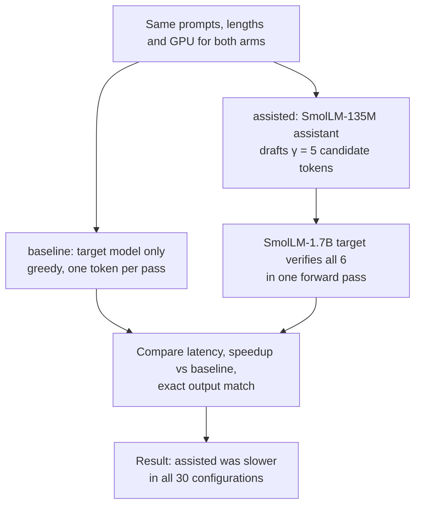

# TinyTurbo — Benchmarking Speculative Decoding for LLM Inference

Can a smaller language model make a larger one generate text faster? TinyTurbo answers that by
benchmarking speculative decoding against ordinary greedy generation on the same GPU, with the same
prompts and generation lengths, measuring latency and output correctness together.

A language model emits one token per forward pass, so latency grows with every token. Speculative
decoding shortens that chain: a small assistant drafts several candidate tokens, the target verifies
them all in one forward pass, and the longest accepted prefix plus one corrected token comes out. But
the assistant is not free, and its passes are serialised with the target's, so the question is whether
the target work saved outweighs the drafting work added. TinyTurbo measures both sides — a 135M
assistant drafting for a 1.7B target, both arms on one Tesla T4, ten prompts, three lengths.

**In this configuration the answer is no.** Assisted decoding was slower at all 30 paired
prompt–length configurations, about 1.9× slower pooled, and the cause is measured rather than
assumed: here a 135M draft pass costs 1.57× a 1.7B target pass. Outputs stayed token-identical to
plain greedy, and the relative loss shrank as generations lengthened — the mechanism behaved as the
theory says it should, and it still did not pay for itself.

---

## Key results

| | |
|---|---|
| Hardware | Tesla T4 (Colab free, 2 vCPU), 15 GB, CUDA 13.0, float16 with SDPA attention |
| Models | target `HuggingFaceTB/SmolLM-1.7B`, assistant `HuggingFaceTB/SmolLM-135M`, both public on the Hub |
| Generation | greedy, 32 / 128 / 256 new tokens, lookahead γ = 5 assistant tokens per verification pass |
| Scope | 10 prompts × 3 lengths = 30 paired prompt–length configurations; × 2 methods = 60 method-specific configurations × 3 measured trials = **180 measured trials**, behind 2 discarded warm-ups each |
| Correctness | token-identical to the paired baseline in **90 / 90** assisted measured trials |
| Runtime | ≈24 minutes of measurement in one Colab session, plus a one-time ≈6.8 GB download |

Speedup always means `baseline latency / assisted-decoding latency`, per prompt–length pair against
its own baseline; **below 1.0× is a slowdown, and every value below is one.** `n` counts paired
measured trials (10 prompts × 3 trials per length), IQR the interquartile range behind a median.

| generation length | n | median end-to-end speedup | IQR | decode-only speedup | tokens per target forward pass |
|---|---|---|---|---|---|
| 32 | 30 | **0.452** | 0.169 | 0.443 | 3.56 |
| 128 | 30 | **0.528** | 0.095 | 0.525 | 4.66 |
| 256 | 30 | **0.592** | 0.066 | 0.591 | 5.17 |
| all | 90 | **0.528** | 0.171 | 0.525 | — |

"Tokens per target forward pass" is what the method is supposed to buy: everything one verification
pass emits — the accepted draft prefix plus the target's own correction token.

* **Every configuration lost.** Per-configuration medians run from 0.659 to 0.303.
* **Correctness held everywhere.** All 90 assisted measured trials produced token ids identical to
  their paired baseline (`exact_match: True`).
* **Accepted length explains the shape, not the outcome.** Fewer verification passes per token is why
  the loss is smallest at 256 tokens; accepted length tracks speedup with a Spearman correlation of
  0.98 pooled (0.91 / 0.97 / 0.97 per length). The trend is real and never reaches break-even.

The lesson: a method can be provably lossless and still lose, because its cost lives in work the
theory treats as free.

---

## Figures


**Figure 1 — the headline measurement.** Median end-to-end speedup of the assisted arm by generation
length; error bars are interquartile ranges over that length's trials. The baseline is the 1.0
reference by construction; every bar sits left of the dashed break-even line.


**Figure 2 — the mechanism, and how far it sits from the model.** One measured point per
(prompt, generation length): median accepted length against median speedup. The two straight lines are
**model predictions, not fits to these points**, drawn only when a calibration from the same machine
exists (see *Calibration*).

The third chart, `plots/time_attribution_*.png`, is a model-derived split, not a profile.

---

## How it works

Both arms share one harness and differ only in how tokens are produced. The **assisted** arm is
`transformers` model-assisted greedy decoding at a fixed lookahead of γ = 5 assistant tokens per step,
with the assistant's confidence threshold disabled so the lookahead cannot adapt mid-generation.



The draft-then-verify step repeats until the token budget is spent. This is the protocol every
measured trial follows; the calibration and the bounded trace are separate measurements taken outside
it. Each trial records both models' forward-pass counts (via forward hooks), a synchronising
wall-clock timing for prefill and the full `generate` call, CUDA memory high-water marks, and the
generated token ids, compared with the paired baseline's to record whether the output sequence is
identical.

Two `transformers` 5.3.0 behaviours would each have silently corrupted the comparison, so both are
pinned in `src/tinyturbo/methods.py` and recorded per trial: the requested lookahead comes from the
assistant's own `generation_config` (default 20, not the documented 5), and
`assistant_confidence_threshold` defaults to 0.4, which would have let the assisted arm adapt its
lookahead mid-generation. Recorded draft passes per target pass came out at 4.79–4.94 against γ = 5
(`docs/FINDINGS.md` §8).

## Experimental setup

| | |
|---|---|
| Runtime | Python 3.13.15, PyTorch 2.11.0+cu130, Transformers 5.3.0, float16 with `sdpa`; bfloat16 is slow on compute capability 7.5 and FlashAttention-2 is unavailable there |
| Per trial | 2 discarded warm-ups then 3 measured trials, arms interleaved so drift cannot masquerade as a treatment effect; ≈3.8 GB peak memory; medians and IQRs, never means |
| Timing | `prefill_ms` is one pass over the prompt with an empty cache, `e2e_ms` is the timed `generate` call, `decode_ms_per_token = (e2e_ms − prefill_ms) / tokens_generated` — so an upper bound on decode time rather than an exact decomposition |

**Calibration (Stage 0).** `tinyturbo calibrate` times three primitives in isolation — one target pass
over a single token, one over γ+1 = 6 tokens, one assistant pass — with warm-ups discarded and 20
timed samples each. It measures the two terms of the cost model `speedup ≈ b / (ρ + κ)`
(`docs/FINDINGS.md` §5) rather than assuming them: ρ is the extra cost of verifying several positions
in one pass, κ the drafting cost relative to the target. On this T4: ρ = 1.147,
κ = 7.858, and a draft pass costing 1.572× a target pass — the ratio the headline rests on, measured
independently of the sweep.

**Bounded CUDA profiling (Stage 4).** `tinyturbo profile` traces the two models' labelled forward
passes with `--trace-active 8` — a window of 8 target passes per arm, since the whole-generation trace
never fit on a free-tier instance. It was meant to attribute per-step cost; what it produced is under
*Results*.

## Results: measured, modelled, and unresolved

**Measured end to end (the benchmark, 180 trials).** Assisted greedy lost at every configuration,
about 1.9× pooled, the loss shrinking as generations lengthened (0.452 → 0.528 → 0.592), and all 90
assisted trials matched their baseline token for token. Accepted length orders the results: 3.56 →
4.66 → 5.17 tokens per target forward pass.

**Measured in isolation (calibration, same card).** A 135M draft pass costs 1.572× a 1.7B target pass
— the same 1.57–1.61× the sweep's own pass counts implied, from a procedure sharing no inputs with it.
With both terms measured, the model predicts 0.395 / 0.517 / 0.574 against observed 0.452 / 0.528 /
0.592: residuals of +0.058 / +0.010 / +0.018, each inside the trial spread at its own length. The cost
is in drafting, not verification — the verification premium is 1.6 % of a modelled iteration.

**Bounded profiler observation, and an unresolved discrepancy.** The trace's per-pass means came out
1.6–2.0× the calibration's isolated primitives, a roughly constant ≈20 ms added per labelled pass,
which is also what compresses the draft/target ratio from 1.572 to 1.29–1.32. Two explanations fit and
this dataset cannot separate them: profiler overhead inside the recording window, and a different
runtime image (the trace ran driver 580.178.04 / CUDA 12.8 / torch 2.11.0+cu128 on Kaggle; the sweep
and calibration ran 580.82.07 / CUDA 13.0 / torch 2.11.0+cu130 on Colab). It is a discrepancy, not a
decomposition; re-running the same command on the calibration's image would settle it
(`docs/FINDINGS.md` §9).

**Modelled, not validated, and still open.** The model is scored by the data rather than fitted to it;
prompt-lookup, the adaptive schedules and ensemble verification were never run, and neither was an
sm80+ comparison.

---

## Reproducing this

```bash
# 1. Clone and build an environment. PyTorch goes first: the right wheel depends on the platform.
git clone https://github.com/yashkapur0403/TinyTurbo.git
cd TinyTurbo
python -m venv .venv
source .venv/bin/activate            # Windows: .venv\Scripts\activate
python -m pip install torch==2.10.0  # CPU wheel, for local development
python -m pip install -r requirements.txt --no-deps
python -m pip install -e . --no-deps

# 2. Check the code: 158 tests, no GPU and no network access required
python -m pytest
```

**Regenerate the published table and figures — no GPU required.** The raw records and the Stage 0
calibration are committed, so `report` works from a clean clone, reproducing the CSV (180 rows) and
the figures byte for byte:

```bash
python -m tinyturbo verify --config configs/gpu_main.yaml   # exit 0 if the records are usable
python -m tinyturbo report --config configs/gpu_main.yaml   # CSV + figures
```

**Re-run the benchmark — needs a CUDA GPU.** Nothing here was measured on CPU, and a CPU run of the
same configuration produces numbers that look like results and are not.

```bash
python -m tinyturbo run --config configs/gpu_main.yaml      # ~24 min on a T4, plus ~6.8 GB of weights
```

`run` resumes rather than repeats, skipping a trial whose `(prompt, length, method, trial)` key is
already recorded, and refuses to append records from a different GPU or driver rather than pooling two
machines into one average. `--force` re-measures; `--trials 1` gives a ~15-minute pass. Then `verify`
and `report` as above.

**CPU smoke test — plumbing only.** `python -m tinyturbo run --config configs/slice_cpu.yaml` (and the
matching `report`) exercises the same code path on a real checkpoint with no GPU, tagged as a smoke run
in the output and on the figures. Its numbers are a plumbing check, because on CPU the assistant is
exactly as expensive as the target — there it is the same checkpoint on both sides.

**Advanced: hosted GPUs, calibration and profiling.** `notebooks/colab_gpu_smoke.ipynb` carries the
hosted sequence (preflight, upload, install, smoke slice, sweep, calibration, bounded trace). Build the
upload bundle with `scripts/make_colab_bundle.py` and install with `requirements-colab.txt` instead of
`requirements.txt`, since a hosted image already ships a CUDA torch. On Kaggle, attach `TinyTurbo.zip`
as a Dataset input before unpacking it — the Stage 4 trace was produced that way. `report` refuses a
calibration whose fingerprint disagrees with the run: it prints the differences, draws figure 2 without
the model lines and writes no attribution chart.

```bash
python -m tinyturbo calibrate --config configs/gpu_main.yaml                    # ρ and κ
python -m tinyturbo profile   --config configs/gpu_main.yaml --trace-active 8   # bounded trace
python -m tinyturbo report    --config configs/gpu_main.yaml                    # re-score
```

---

## Project layout

```text
src/tinyturbo/     config, fingerprint, prompts, models, instrumentation, methods, metrics,
                   runner, report, calibrate (Stage 0) and profiling (Stage 4)
configs/           the fixed prompt set, the main sweep, and single-point slice configs
tests/             158 tests, no GPU and no network access needed
results/           raw/ (the evidence), sessions/, calibration/, profiling/, and the derived CSV
docs/              PLAN.md (the pre-registered plan) and FINDINGS.md (the full analysis)
```

## Limitations

* **One machine, one configuration, and the cost model is scored on it.** One T4, one model pair,
  γ = 5, greedy decoding only, compute capability 7.5 only, one session — so the model's agreement
  with the sweep is not evidence that it generalises.
* **Three measured trials per configuration is thin for adjacent points.** The IQR at 32 tokens (0.169)
  exceeds the gap between the 32- and 256-token medians (0.140): the trend across lengths is solid,
  individual configurations are not.
* **The profiler evidence is a bounded window on a different image**, which is why `attributed_ms` and
  `unattributed_ms` are `null` and the ≈20 ms per-pass discrepancy with the calibration is unresolved.
* **The prompt set is ten hand-written prompts, and its long-open stratum is shorter than designed.**
  Specified at 300–1000 tokens, it tokenises to 174–188, so workload dependence is tested over short
  prompts and prefill dilution's magnitude is untestable here (`docs/FINDINGS.md` §7).

---

## Further information

| | |
|---|---|
| Full analysis and the pre-registered plan | [`docs/FINDINGS.md`](docs/FINDINGS.md), [`docs/PLAN.md`](docs/PLAN.md) |
| Run log: every run, its machine and its command | [`results/README.md`](results/README.md) |
| The sweep's checksums, scope and open ends | [`results/sessions/gpu-main-9e26c12945e6/README.md`](results/sessions/gpu-main-9e26c12945e6/README.md) |
| Raw evidence, artifacts, configs, notebook | [`results/`](results), [`plots/`](plots), [`configs/gpu_main.yaml`](configs/gpu_main.yaml), [`notebooks/colab_gpu_smoke.ipynb`](notebooks/colab_gpu_smoke.ipynb) |

Raw records hold observations only — every speedup is computed at report time from a paired baseline —
and `validate_run` refuses to report a trial that cannot be traced to its run manifest.
